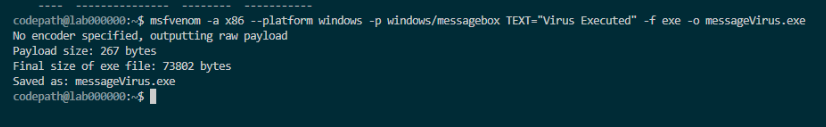
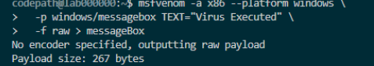
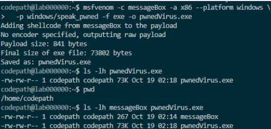
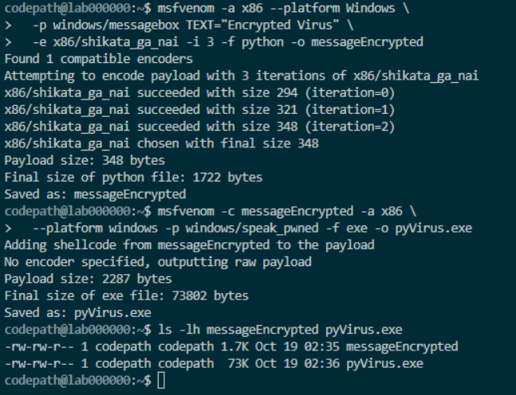
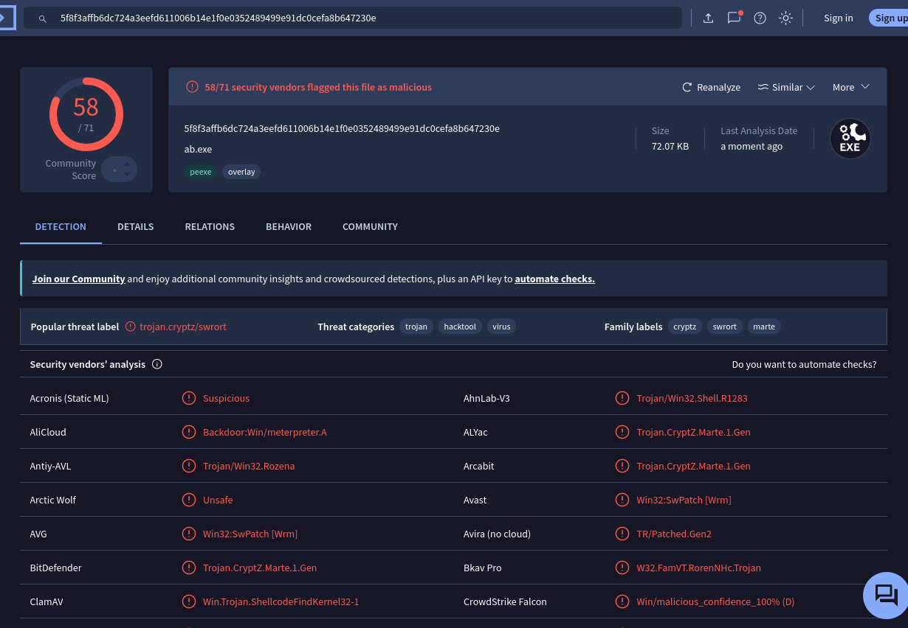

# DIY Malware — Technical Project Walkthrough

**Course:** CodePath Cybersecurity 101 (CYB101)  
**Week:** 5 — Malware Detection  
**Project:** DIY Malware  
**Status:** Completed

## Project Objective

Investigate executable payload formats, combined payloads, polymorphic encoding, and antivirus detection in an authorized educational environment.

The project consisted of three required challenges and an optional VirusTotal investigation.

All executable files were created and retained within the course-provided Ubuntu virtual machine. No executable payloads are distributed through this repository.

## Lab Environment

| Component | Description |
|---|---|
| Operating system | Ubuntu Linux virtual machine |
| Remote access | SSH through VS Code; RDP for graphical access |
| Security tools | Metasploit MSFVenom, VirusTotal CLI |
| File analysis | Linux commands and SHA-256 |
| Documentation | Markdown, VS Code, GitHub |

## Challenge 1 — Single-Payload Analysis

### Objective

Explore a basic Windows message-box payload and inspect the resulting executable.

### Observations

The lab tool reported:

| Property | Result |
|---|---|
| Payload architecture | x86 |
| Target platform | Windows |
| Payload type | Message box |
| Raw payload size | 267 bytes |
| Executable size | 73,802 bytes |
| Output file | `messageVirus.exe` |

The resulting executable was significantly larger than the raw payload because executable files contain additional structure and supporting data.

### Evidence

## Challenge 2 — Multiple-Payload Analysis

### Objective

Explore how multiple payload components can be incorporated into a single executable.

### Observations

The first stage produced a raw payload file. The second stage incorporated additional payload content.

| Property | Result |
|---|---|
| Raw payload file | `messageBox` |
| Raw payload size | 267 bytes |
| Combined payload size | 841 bytes |
| Executable size | 73,802 bytes |
| Output file | `pwnedVirus.exe` |

The project introduced the Windows speech demonstration payload, which is designed to produce the spoken phrase "You Got Pwned!"

The terminal output confirmed file creation; it did not independently establish successful execution.

### Troubleshooting

During my initial attempt, the tool returned a file-not-found error because the raw payload file had not yet been created.

I investigated the error, practiced output redirection using a harmless text file, and verified that the required file existed before proceeding.

### Evidence

**Raw payload:**

**Combined payload:**

## Challenge 3 — Polymorphic Encoding

### Objective

Investigate how an encoder transforms payload data and how encoding differs from encryption.

### Encoder Studied

`x86/shikata_ga_nai` — Polymorphic XOR Additive Feedback Encoder.

### Observations

Three encoding iterations were completed.

| Stage | Reported size |
|---|---:|
| First iteration | 294 bytes |
| Second iteration | 321 bytes |
| Third iteration | 348 bytes |
| Python-format output | 1,722 bytes |
| Combined payload | 2,287 bytes |
| Final executable | 73,802 bytes |

**Generated files:** `messageEncrypted` and `pyVirus.exe`.

### Technical Explanation

Polymorphic encoding can produce different byte representations of payload data.

XOR is a reversible bitwise operation used in the encoder's transformation process.

Encoding is not equivalent to cryptographic encryption and does not guarantee that a payload will avoid antivirus detection.

### Evidence

## Optional Investigation — VirusTotal

### Objective

Investigate whether VirusTotal had existing analysis reports for the generated files and examine antivirus detection classifications.

### SHA-256 Analysis

I generated SHA-256 fingerprints for all three executable files.

My initial VirusTotal CLI searches returned `File not found` for each hash, indicating that no matching reports were available at that time.

### VirusTotal Detection Result

I subsequently submitted the single-payload executable directly from the authorized Ubuntu lab environment.

| File | Malicious detections | Percentage |
|---|---:|---:|
| `messageVirus.exe` | 58/71 | 81.7% |
| `pwnedVirus.exe` | Not measured | N/A |
| `pyVirus.exe` | Not measured | N/A |

The results show that a substantial majority of the reporting security vendors classified the first executable as malicious.

Because the remaining files were not analyzed, the project does not establish whether combining payloads or applying encoding changed detection rates.

### Evidence

## Linux Commands Practiced

| Command | Purpose |
|---|---|
| `pwd` | Confirm the current working directory |
| `ls -lh` | Inspect files and their sizes |
| `sha256sum` | Calculate SHA-256 fingerprints |
| `vt file` | Search VirusTotal for an existing report |
| `grep` | Filter command output |
| `>` | Redirect output into a file |

## Technical Findings

1. Raw payloads and executable files have different sizes and structures.
2. Combining payload components increases the amount of payload data.
3. Repeated encoding can change payload byte patterns and sizes.
4. File hashes identify exact file contents.
5. A missing VirusTotal report does not indicate that a file is safe.
6. Antivirus classifications must be interpreted using available evidence.

## Ethical and Safety Considerations

All activities were performed within an authorized CodePath educational environment.

No executable files, raw shellcode, malware samples, credentials, or sensitive VM connection details are included in this repository.

## Related Documentation

- [Project Overview](README.md)
- [Project Reflection](reflection.md)
- [Week 5 Overview](../../README.md)