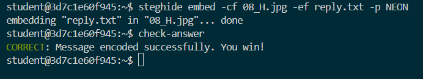

# The Artist's Message: Steganography Investigation

## Project Overview

**Course:** CodePath Cybersecurity 101  
**Week:** 6  
**Topic:** Steganography and Digital Forensics  
**Status:** Completed and verified

In this graded project, I investigated 26 JPEG images to locate a concealed message. Using image metadata, Linux commands, and steganography tools, I identified the correct image, extracted hidden instructions, and embedded a reply into another JPEG.

The objective was to complete the investigation and verify that the response was successfully encoded.

To preserve the integrity of the graded challenge, exact filenames, passphrases, and hidden messages have been omitted.

## Tools and Technologies

- Linux Bash
- Docker
- ExifTool
- Steghide
- VS Code
- PowerShell

## Investigation and Methodology

### 1. Examine the image collection

I began by inspecting the files in the Docker lab environment.

```bash
ls -lah
```

The directory contained 26 JPEG images.

I investigated their metadata using ExifTool.

```bash
exiftool -a -G1 -s *.jpg
```

I also used command-line filtering to identify metadata associated with the challenge.

```bash
exiftool -a -G1 -s *.jpg | grep -i artist
```

**Command explanation:**

- `exiftool` reads image metadata.
- `-a` allows duplicate tags to be displayed.
- `-G1` displays metadata group names.
- `-s` uses shorter tag names.
- `grep -i` searches for matching text without case sensitivity.
- `|` passes the output of one command to another.

### 2. Narrow down the candidate images

I used metadata conditions to reduce the number of images requiring further investigation.

The investigation involved comparing author information, image dimensions, and descriptive metadata.

A general example of ExifTool filtering is:

```bash
exiftool -if '$ImageWidth > 100' -FileName -ImageWidth *.jpg
```

I then examined image titles to identify unusual information that could serve as an investigative clue.

```bash
exiftool -Title *.jpg
```

This process demonstrated how metadata analysis can narrow a large collection of files into a smaller set of candidates.

### 3. Investigate concealed information

After identifying a promising image, I used Steghide to determine whether it contained embedded data.

General command structure:

```bash
steghide info <image.jpg> -p <passphrase>
```

Steghide confirmed the presence of a concealed file.

I then extracted the hidden information.

```bash
steghide extract -sf <image.jpg> -xf <output.txt> -p <passphrase>
```

**Command explanation:**

- `steghide` is a tool for hiding and extracting information.
- `info` inspects a supported file for embedded information.
- `extract` retrieves concealed content.
- `-sf` specifies the stego file.
- `-xf` specifies the extracted output file.
- `-p` supplies a passphrase.

The extracted instructions provided the next stage of the challenge.

### 4. Create and embed a reply

I created a text file containing my response.

General command structure:

```bash
echo "Example response" > reply.txt
```

I verified its contents using:

```bash
cat reply.txt
```

Then I embedded the reply into the designated image.

```bash
steghide embed -cf <cover-image.jpg> -ef reply.txt -p <passphrase>
```

**Command explanation:**

- `embed` conceals data inside a supported file.
- `-cf` specifies the cover file.
- `-ef` specifies the file containing the message.
- `-p` specifies the passphrase.

The terminal confirmed that the embedding operation completed successfully.

The commands above are illustrative templates. The exact challenge-specific arguments are intentionally omitted.

### 5. Verify the result

I ran the lab's built-in verification command.

```bash
check-answer
```

**Final verification result:**

```text
CORRECT: Message encoded successfully. You win!
```

The verification tool accepted my encoded response.

## Technical Troubleshooting

### Docker image compatibility

During setup, the published lab container image could not run in my Windows Docker environment because a compatible Linux image manifest was unavailable.

I resolved the issue by cloning the official CodePath lab repository and building the Docker image locally.

```powershell
docker build -t codepath-steganography -f docker/Dockerfile .
```

This gave me a locally built container image for the lab.

### Windows and Linux line-ending compatibility

When starting the container, I encountered an error involving `bash\r`.

The issue was related to Windows-style line endings in the container's startup script.

I bypassed the affected entrypoint:

```powershell
docker run --rm -it --entrypoint /bin/bash codepath-steganography
```

This allowed me to access the Linux environment, continue the investigation, and successfully complete the project.

## Skills Demonstrated

- Image metadata investigation
- Linux command-line filtering
- File inspection and extraction
- Password-protected steganography
- Concealed message embedding
- Docker image building
- Cross-platform troubleshooting
- Technical documentation
- Evidence-based problem-solving

## Reflection

This project helped me understand how hidden information can be discovered through a combination of metadata analysis and steganography tools.

One important lesson was that investigating metadata is different from extracting concealed content. ExifTool helped me identify clues, while Steghide allowed me to recover and embed actual hidden files.

I also gained experience troubleshooting Docker problems across Windows and Linux environments. Rather than abandoning the project when the original container failed, I investigated an alternative way to run the lab.

The most valuable part of this exercise was following a repeatable investigation process: inspect, filter, form a hypothesis, test, extract, and verify.

## Evidence

### Successful Project Verification

The screenshot below documents successful completion of the CodePath Week 6 graded steganography project.

